# Cloudflare ハンズオン手順書

講義「Cloudflare 入門」の後半で行うハンズオンです。すべて **Cloudflare の無料プラン** で終わります。

| パート | 内容 | 使うもの | 目安 |
|---|---|---|---|
| 0 | 準備（アカウントと Node.js） | ブラウザ、ターミナル | 10 分 |
| 1 | Web サイトを公開する | ブラウザ | 5 分 |
| 2 | R2（ファイル置き場）にファイルを保存する | ブラウザ | 5 分 |
| 3 | AI Playground でモデルを試す | ブラウザ | 5 分 |
| 4 | Workers AI でチャット API を作る | ターミナル | 15 分 |
| 5 | リモート MCP サーバーを作り、AI から呼ぶ | ターミナル、ブラウザ | 15 分 |
| 6 | 片付け | ブラウザ | 3 分 |

> 画面は 2026 年 10 月時点の日本語表示です。Cloudflare の画面はよく変わるので、ボタンの位置が違っていたら、同じ名前のボタンを探してください。
> スクリーンショット中のアカウント名・サブドメインは `your-account`・`your-subdomain` に置き換えてあります。

完成したコードは、このフォルダの [handson-chat-api](handson-chat-api/) と [handson-mcp-server](handson-mcp-server/) にあります。詰まったら見比べてください。

---

## パート 0：準備

### 0-1. Cloudflare アカウントを作る

1. <https://dash.cloudflare.com/sign-up> を開き、メールアドレスとパスワードで登録します。
2. 届いた確認メールのリンクを開きます。
3. ログインすると、次のようなホーム画面が出ます。左のメニューがサービスの一覧です。

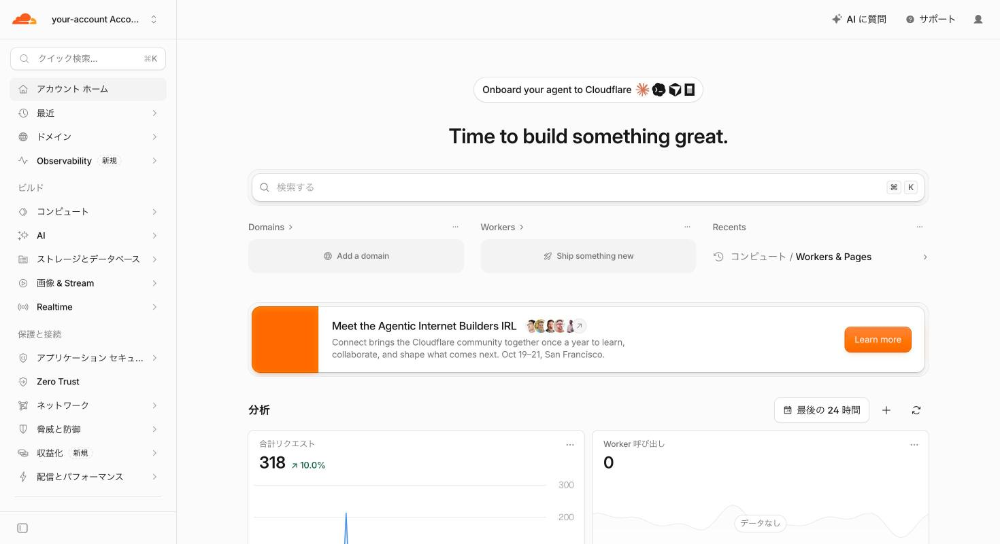

### 0-2. ターミナルを開く

パート 4 と 5 では、文字でコンピューターに命令する「ターミナル」を使います。

- **Mac**：`command + スペース` で Spotlight を開き、「ターミナル」と入力して Enter
- **Windows**：スタートメニューで「PowerShell」を検索して開く

この手順書の灰色の枠に書かれたコマンドは、**1 つずつコピーしてターミナルに貼り付け、Enter** で実行します。

### 0-3. Node.js をインストールする

Cloudflare の開発用ツール（wrangler）は Node.js の上で動きます。

1. <https://nodejs.org/ja> を開き、**LTS（推奨版）** のインストーラーをダウンロードして実行します。設定はすべてそのままで「続ける」「次へ」を押します。
2. ターミナルを **一度閉じて開き直し**、次のコマンドを実行します。

```bash
node -v
```

`v24.x.x` のように `v` から始まるバージョンが表示されれば成功です。`command not found` と出たら、ターミナルを開き直してもう一度試してください。

---

## パート 1：Web サイトを公開する（画面操作）

HTML ファイルを 1 つドラッグするだけで、世界中から見られる Web サイトを公開します。サーバーの用意も HTTPS の設定もいりません。

> 以前はこの用途に「Pages」というサービスを使っていました。今は Cloudflare が **Workers での公開を推奨** しているので、ここでも Workers を使います。

### 1-1. 公開する HTML を用意する

このフォルダの [static-site/index.html](static-site/index.html) を使います。自分で作る場合は、`index.html` という名前で好きな内容の HTML を作ってください。

### 1-2. アップロード画面を開く

1. 左メニューの **コンピュート** → **Workers & Pages** を開きます。
2. 右上の **アプリケーションを作成する** を押します。
3. **Upload your static files** を選びます。

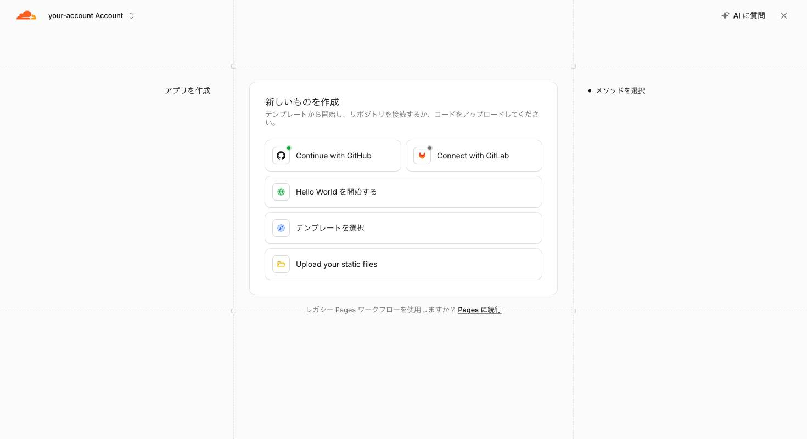

### 1-3. ファイルをドラッグして名前を付ける

1. 点線の枠に `index.html` をドラッグします（クリックしてファイルを選んでも構いません）。

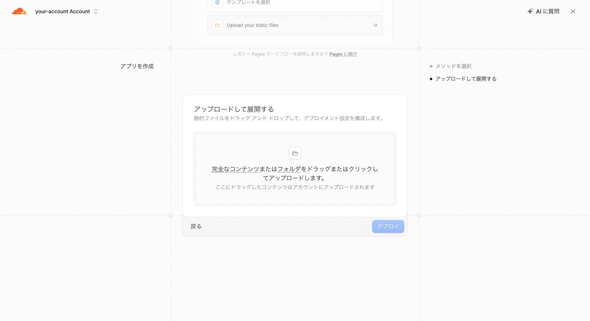

2. 「ワーカー名」を `handson-static-site` に変えます。この名前が URL の一部になります。
3. **デプロイ** を押します。

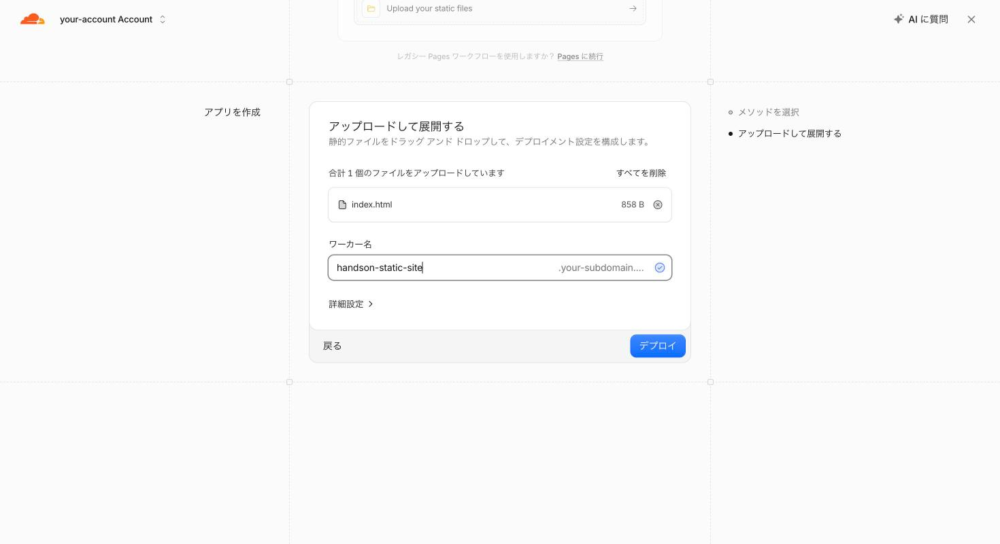

### 1-4. 公開されたことを確認する

数秒でデプロイが終わり、次の画面になります。上部の `handson-static-site.<あなたのサブドメイン>.workers.dev` が、あなたのサイトの URL です。

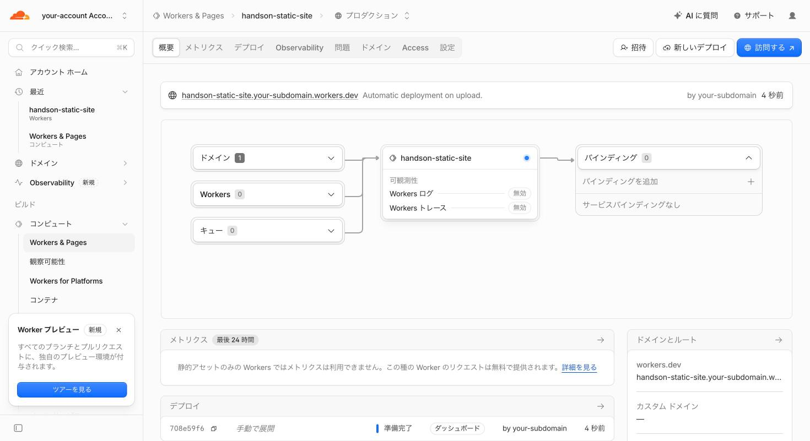

右上の **訪問する** を押すと、公開されたページが開きます。スマホからも同じ URL で見られます。

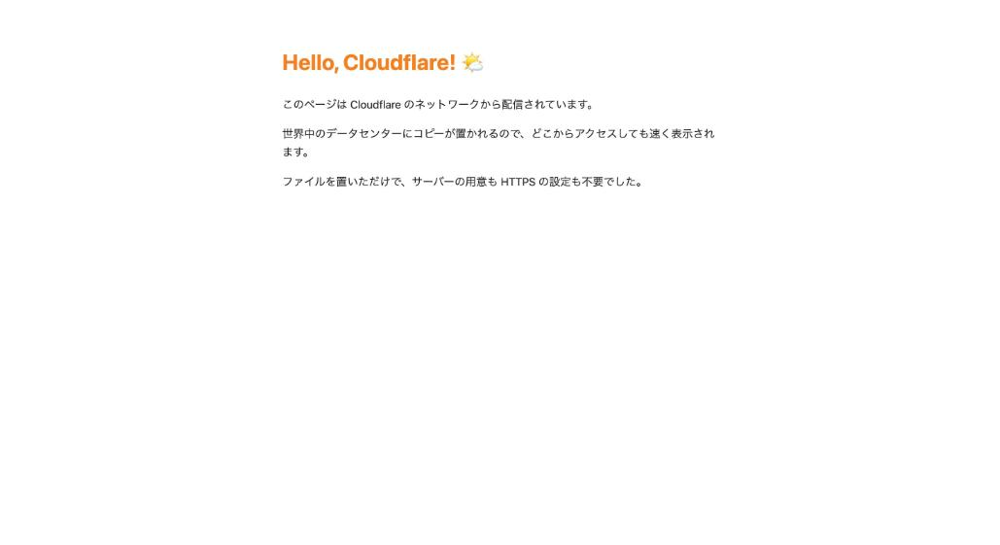

> **何が起きたのか**：アップロードした HTML のコピーが Cloudflare の世界中のデータセンターに置かれ、見る人の一番近くから返されています。講義の「速くする（キャッシュ）」の部分です。

---

## パート 2：R2 にファイルを保存する（画面操作）

R2 は、画像や動画、AI の学習データなどを置いておくファイル置き場です。他社のクラウドではデータを取り出すたびに料金（エグレス料金）がかかりますが、R2 ではかかりません。

### 2-1. R2 を使えるようにする

1. 左メニューの **ストレージとデータベース** → **R2 オブジェクトストレージ** を開きます。
2. 初めて開くと、無料枠の説明とサブスクリプションの登録画面が出ます。

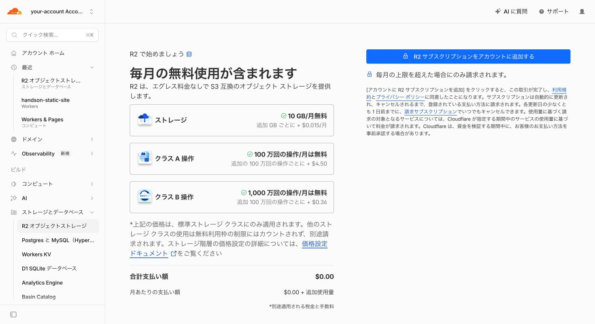

画面のとおり、毎月 10 GB の保存、100 万回の書き込み系の操作、1,000 万回の読み取り系の操作までは無料です（合計支払い額 $0.00）。

> **注意**：R2 は **無料枠の中で使う場合でも、最初に「R2 サブスクリプションをアカウントに追加する」で支払い方法（クレジットカードなど）の登録が必要** です。無料枠を超えた分だけが請求されます。登録したくない人はこのパートを読むだけにして、パート 3 へ進んでください。

3. 登録を済ませると、R2 のトップ画面になります。右上の **バケットを作成** を押します。バケットは、ファイルを入れる「箱」です。

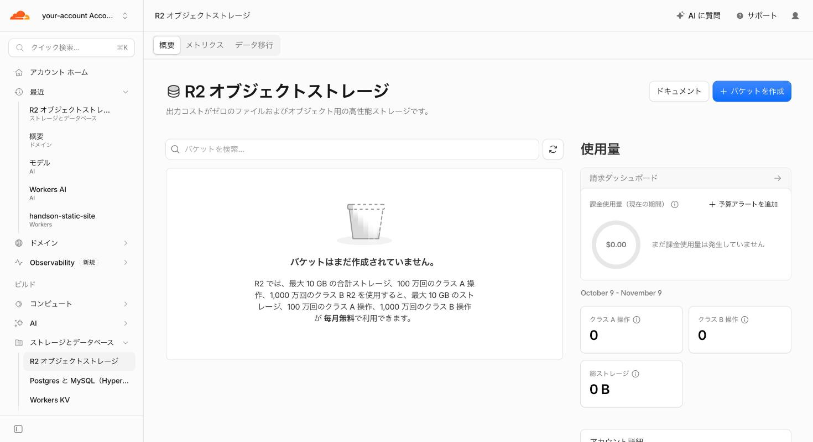

### 2-2. バケットを作る

1. **バケット名** に `handson-bucket` と入力します（名前は後から変えられません）。
2. 位置情報とストレージクラスは、そのまま（**自動**・**Standard**）で構いません。

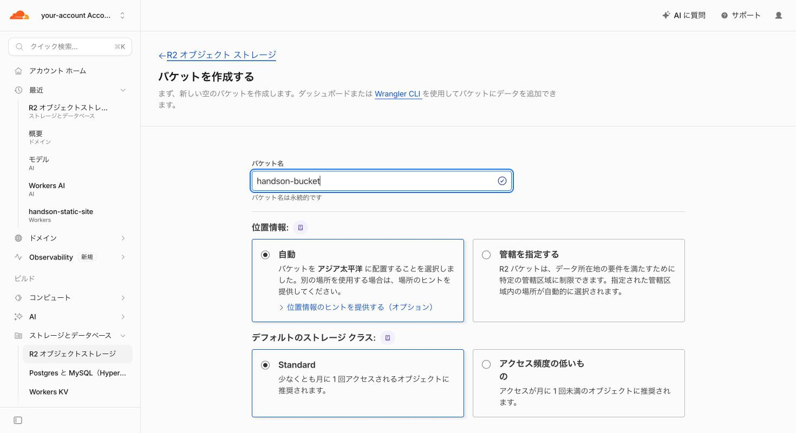

3. 下までスクロールして **バケットを作成** を押します。

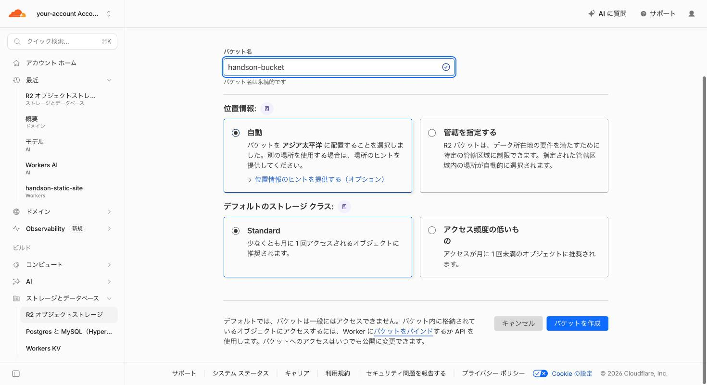

> 画面の説明にあるとおり、作ったバケットは標準では **外から見られません**。中身を使うには、Worker から「バインド」するか API を使います。

### 2-3. ファイルを入れる

空のバケットが開きます。点線の枠にファイルをドラッグするか、**コンピュータから選択します** を押してファイルを選びます。このフォルダの [r2-sample/hello-r2.txt](r2-sample/hello-r2.txt) を使ってください。

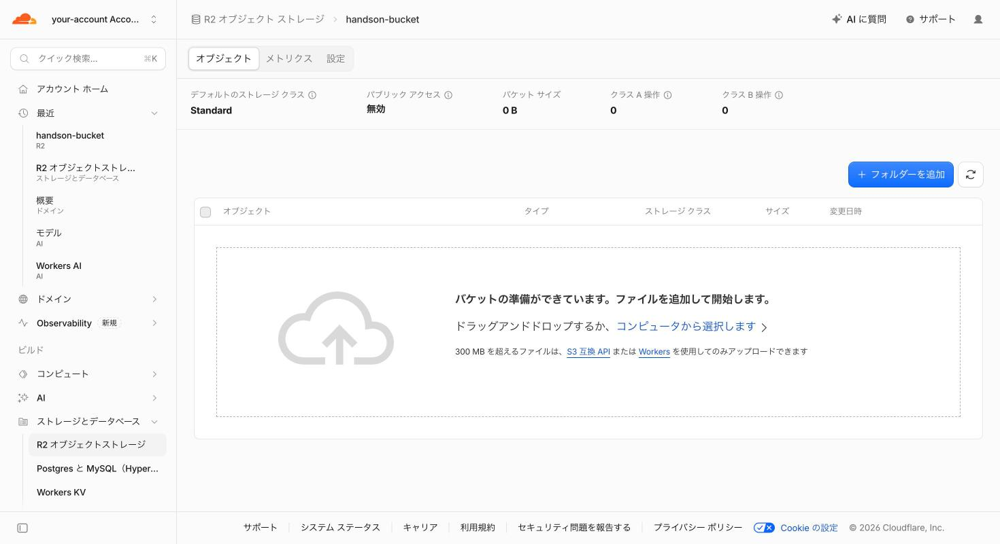

アップロードが終わると、一覧にファイルが表示されます。ファイル名を押すと、中身の確認やダウンロードができます。

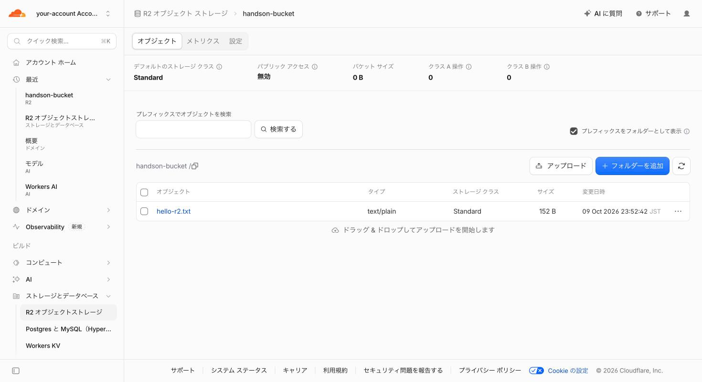

> **AI との関係**：R2 は、AI の学習データや、RAG で検索させる資料の置き場としてよく使われます。Cloudflare の AI Search も、R2 に置いたファイルを検索対象にできます。

---

## パート 3：AI Playground でモデルを試す（画面操作）

ログインなしで、Cloudflare 上の AI モデルをブラウザから試せます。

### 3-1. Playground を開く

1. <https://playground.ai.cloudflare.com/> を開きます。
2. **Model mode** を選びます。

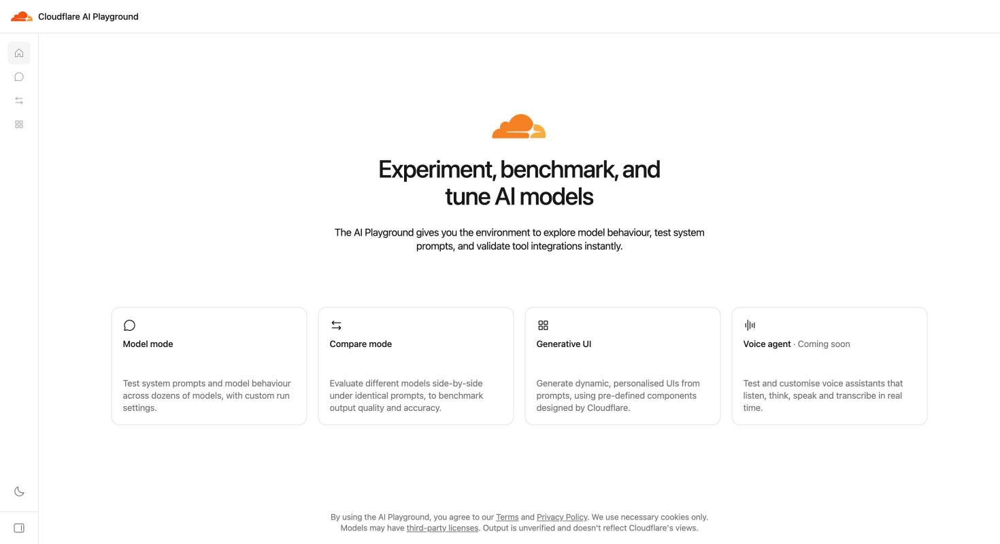

### 3-2. 質問してみる

右側でモデルを選び、下の入力欄に質問を書いて送信します。

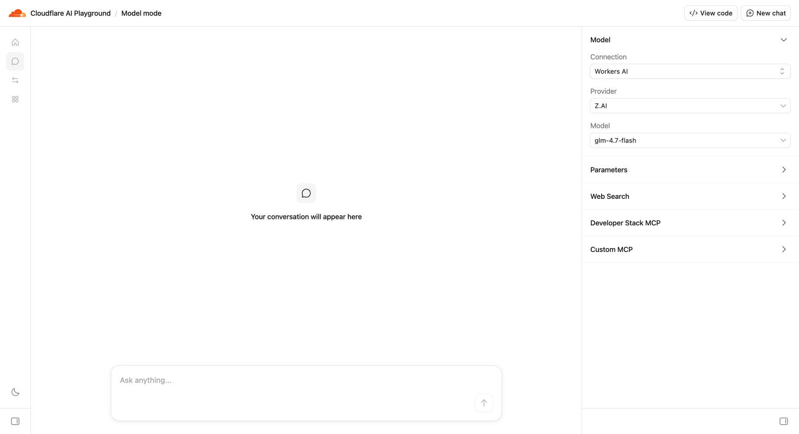

例：「Cloudflareとは何の会社ですか？中学生にもわかるように3行で説明して」

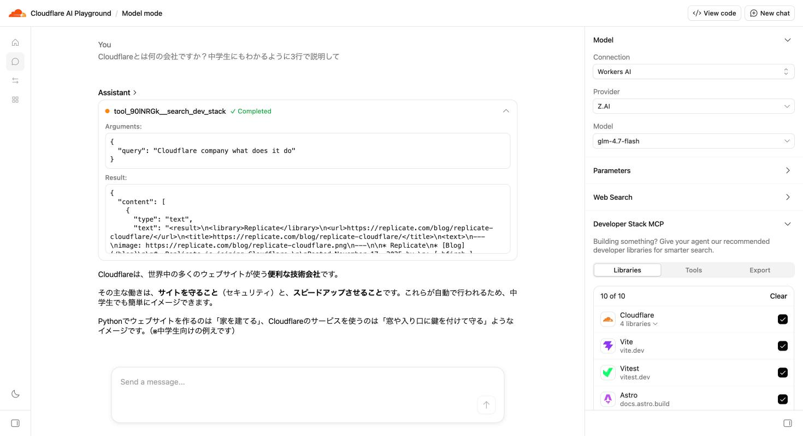

回答の上に `search_dev_stack` というツール呼び出しが出ることがあります。これは右側の **Developer Stack MCP** が標準でオンになっていて、AI が Cloudflare のドキュメントを MCP 経由で検索したためです。パート 5 では、ここに自分の MCP サーバーをつなぎます。

### 3-3. モデルを切り替える

**Provider** を開くと、Meta・Google・OpenAI・Mistral・Qwen・DeepSeek など、さまざまな会社のモデルを選べます。同じ質問をモデルごとに比べてみてください。

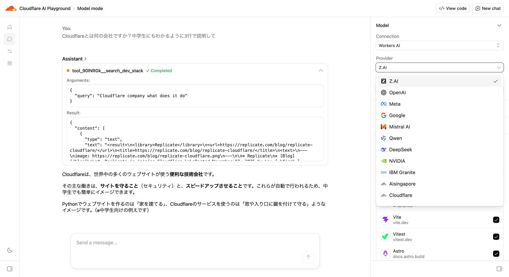

> 左の ⇆ アイコン（**Compare mode**）を使うと、2 つのモデルの答えを並べて比べられます。

### 3-4. ダッシュボードでモデル一覧を見る

ダッシュボードの左メニュー **AI** → **モデル** には、使えるモデルの一覧があります。2026 年 10 月時点で 242 件あり、画像生成や音声のモデルも含まれます。各カードの **ID をコピー** で、パート 4 のコードで使うモデル ID を取得できます。

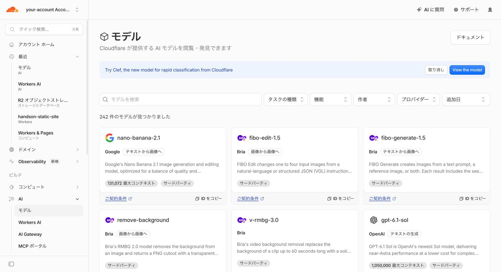

---

## パート 4：Workers AI でチャット API を作る（ターミナル）

ここからはコードを書きます。最終的に、ブラウザで使えるチャット画面と、ほかのプログラムから呼べる API ができます。

```
ブラウザ ──「質問」──▶ あなたの Worker ──▶ Workers AI（GPU でモデルを実行）
        ◀──「回答」──            ◀──
```

### 4-1. プロジェクトを作る

作業用のフォルダに移動してから、次のコマンドを実行します（`cd` は「フォルダに移動する」という意味です）。

```bash
cd ~/Desktop
```

```bash
npm create cloudflare@latest -- handson-chat-api
```

初回は「`create-cloudflare` をインストールしますか？」と聞かれるので `y` を押します。続いて質問が出るので、矢印キーで選んで Enter を押します。

| 質問 | 選ぶもの |
|---|---|
| What would you like to start with? | **Hello World example** |
| Which template would you like to use? | **Worker only** |
| Which language do you want to use? | **TypeScript** |
| Do you want to use git for version control? | **No** |
| Do you want to add an AGENTS.md file …? | **Yes**（AI コーディングツール向けの説明ファイル。どちらでも可） |
| Do you want to deploy your application? | **No** |

`SUCCESS Application created successfully!` と出たら完了です。作ったフォルダに移動します。

```bash
cd handson-chat-api
```

### 4-2. Workers AI を使えるようにする

コードから AI を呼ぶには、設定ファイルに「AI を使います」と書きます。これを **バインディング** と呼びます。

1. `handson-chat-api` フォルダの `wrangler.jsonc` をテキストエディタ（VS Code など）で開きます。
2. `"upload_source_maps": true` の行を探し、行末に `,` を足してから、その下に `"ai"` の 3 行を追加します。

```jsonc
	"upload_source_maps": true,
	"ai": {
		"binding": "AI"
	}
```

3. 保存したら、ターミナルで次を実行します。コードの中で `env.AI` を使えるように、型の情報が更新されます。

```bash
npx wrangler types
```

### 4-3. コードを書く

`src/index.ts` の中身を **すべて消して**、[handson-chat-api/src/index.ts](handson-chat-api/src/index.ts) の内容を貼り付けて保存します。ポイントは次の部分です。

```ts
const MODEL = "@cf/google/gemma-4-26b-a4b-it";

const result: any = await env.AI.run(MODEL, {
	messages: [
		{ role: "system", content: SYSTEM_PROMPT },
		{ role: "user", content: body.message },
	],
});
```

`env.AI.run(モデルID, 入力)` の 1 行で、Cloudflare の GPU 上でモデルが動きます。API キーの管理も GPU の用意もいりません。`MODEL` をパート 3-4 で調べた別のモデル ID に変えれば、モデルを切り替えられます。

### 4-4. Cloudflare にログインする

```bash
npx wrangler login
```

ブラウザが開き、wrangler にアカウントの操作を許可するか聞かれます。内容を確認して **Allow** を押してください。ターミナルに `Successfully logged in.` と出たら完了です。

### 4-5. 公開する

```bash
npx wrangler deploy
```

成功すると、最後に次のような URL が表示されます。

```
Your Worker has access to the following bindings:
Binding        Resource
env.AI         AI

Uploaded handson-chat-api (1.42 sec)
Deployed handson-chat-api triggers (0.81 sec)
  https://handson-chat-api.<あなたのサブドメイン>.workers.dev
```

### 4-6. 使ってみる

表示された URL をブラウザで開くと、チャット画面が出ます。質問を入力して **送信** を押します。

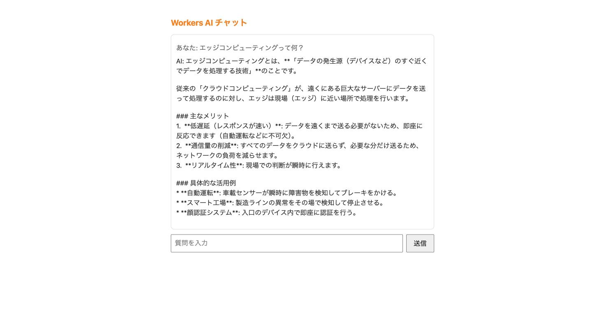

ほかのプログラムからは、API として呼べます。ターミナルで次を実行してみてください（URL は自分のものに変えます）。

```bash
curl -X POST https://handson-chat-api.<あなたのサブドメイン>.workers.dev/chat -H "content-type: application/json" -d '{"message":"Cloudflare Workersを一言で説明して"}'
```

```json
{"reply":"世界中のエッジ（ユーザーの近く）で、サーバー管理不要でプログラムを実行できるサーバーレスプラットフォームです。"}
```

> Windows の PowerShell では `curl` の書き方が違うため、このコマンドは動かないことがあります。その場合はブラウザのチャット画面で確かめれば十分です。

### 4-7. 使った量を確認する

ダッシュボードの **AI** → **Workers AI** を開くと、今日使った「ニューロン」（AI の計算量の単位）が表示されます。無料枠は 1 日 1 万ニューロンで、何回か試しても数十ニューロンしか使いません。

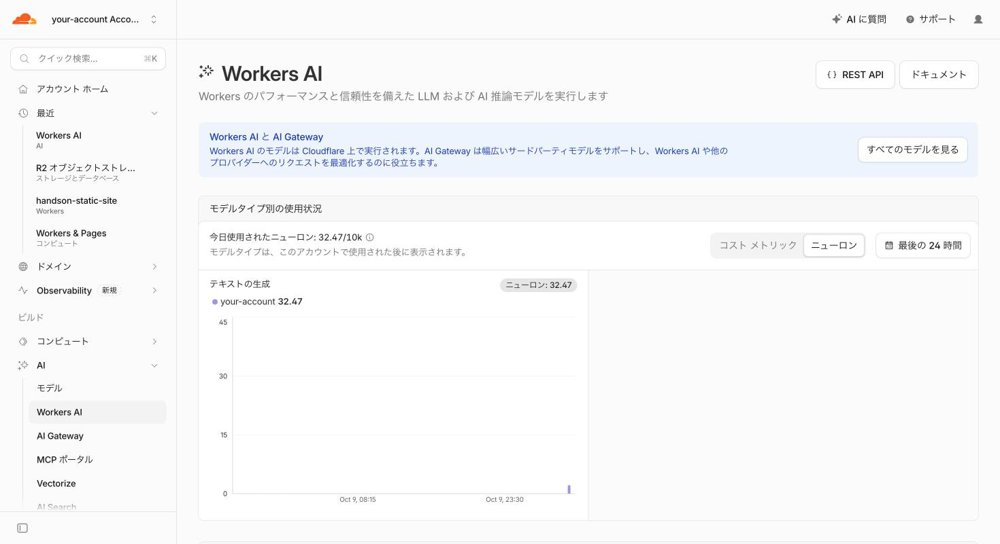

---

## パート 5：リモート MCP サーバーを作り、AI から呼ぶ

MCP（Model Context Protocol）は、AI にツールを使わせるための共通の規格です。ここでは「サイコロを振る」ツールを持つ MCP サーバーを作り、インターネットに公開して、AI Playground から呼び出します。

```
AI Playground（AI）──「どんなツールがある？」──▶ あなたの MCP サーバー（Workers）
                 ──「roll_dice を 3 個で」──▶   サイコロを振る
                 ◀──「出た目: 3, 6, 1」────
```

> AI は本当の意味でのランダムな数を作れません。ツールに任せれば、本物の乱数で答えられます。「AI ができないことを、ツールで補う」のが MCP の基本的な使い方です。

### 5-1. テンプレートからプロジェクトを作る

まず、作業用フォルダに戻ります。

```bash
cd ~/Desktop
```

Cloudflare 公式の「認証なし MCP サーバー」テンプレートを使います。

```bash
npm create cloudflare@latest -- handson-mcp-server --template=cloudflare/ai/demos/remote-mcp-authless
```

| 質問 | 選ぶもの |
|---|---|
| Do you want to add an AGENTS.md file …? | **No** |
| Do you want to use git for version control? | **No** |
| Do you want to deploy your application? | **No** |

```bash
cd handson-mcp-server
```

`wrangler.jsonc` を開き、`"name"` が `"handson-mcp-server"` になっていることを確認します。`"remote-mcp-server-authless"` のままなら、`"handson-mcp-server"` に書き換えて保存してください。

### 5-2. ツールを追加する

`src/index.ts` を開くと、テンプレートには足し算（`add`）と計算（`calculate`）の 2 つのツールが入っています。`return server;` という行の **すぐ上** に、次のサイコロのツールを貼り付けて保存します。

```ts
	// ハンズオンで追加するツール: サイコロを振る
	server.registerTool(
		"roll_dice",
		{
			description: "サイコロを振って出た目を返す。sides で面の数、count で個数を指定できる",
			inputSchema: z.object({
				sides: z.number().int().min(2).default(6),
				count: z.number().int().min(1).max(10).default(1),
			}),
		},
		async ({ sides, count }) => {
			const rolls = Array.from({ length: count }, () => Math.floor(Math.random() * sides) + 1);
			return {
				content: [{ type: "text", text: `出た目: ${rolls.join(", ")}（合計 ${rolls.reduce((a, b) => a + b, 0)}）` }],
			};
		},
	);
```

読み方：

- `"roll_dice"`：ツールの名前
- `description`：AI がこれを読んで「いつ使うか」を判断する。**ここを分かりやすく書くのが一番大事**
- `inputSchema`：受け取る引数の形（面の数と個数）
- `async (...) => {...}`：実際の処理。結果を文字で返す

完成形は [handson-mcp-server/src/index.ts](handson-mcp-server/src/index.ts) です。

### 5-3. 公開する

パート 4 でログイン済みなので、そのまま公開できます。

```bash
npx wrangler deploy
```

最後に `https://handson-mcp-server.<あなたのサブドメイン>.workers.dev` と表示されます。MCP サーバーの住所は、これに **`/mcp` を付けたもの** です。

> この URL をブラウザで直接開いても、何も表示されないかエラーになります。MCP のやり取り専用の窓口なので、それで正常です。

### 5-4. AI Playground につなぐ

1. <https://playground.ai.cloudflare.com/> を開き、**Model mode** に入ります。
2. 右上の **New chat** で新しい会話にします。
3. 右側の **Custom MCP** を開き、**Add server** を押します。

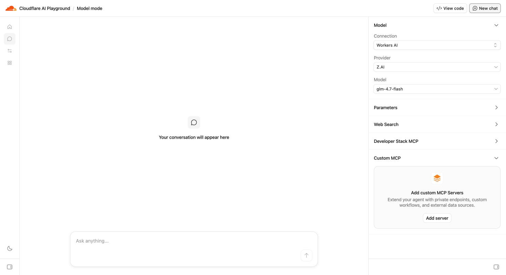

4. **Server URL** に `https://handson-mcp-server.<あなたのサブドメイン>.workers.dev/mcp` を入力し、**Add server** を押します。

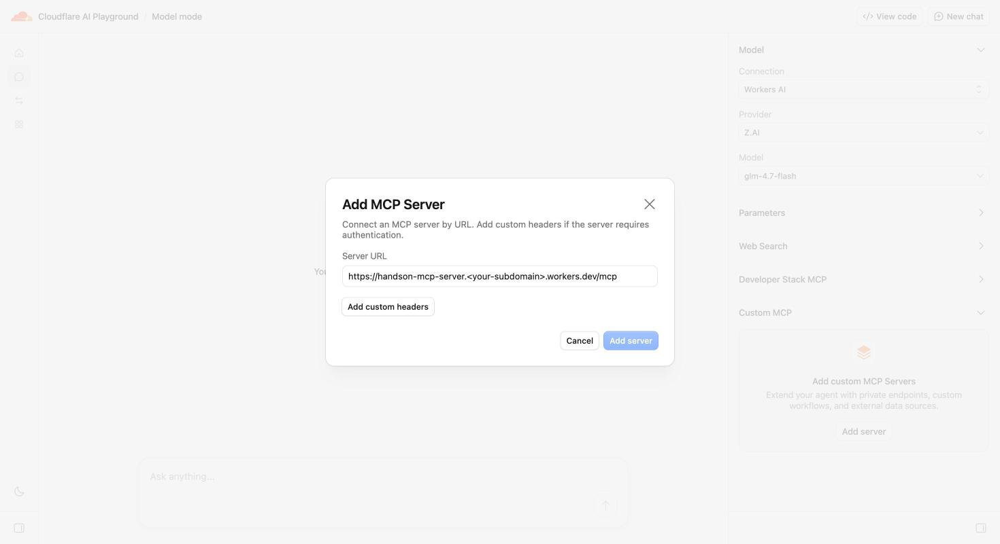

5. サーバーの下に **Ready** と出れば接続成功です。

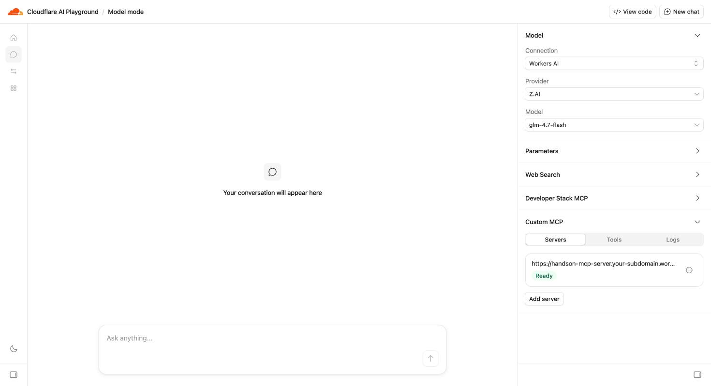

6. **Tools** タブを開くと、`add`・`calculate`・`roll dice` の 3 つのツールが見えます。自分で追加した `roll_dice` が AI から見えている状態です。

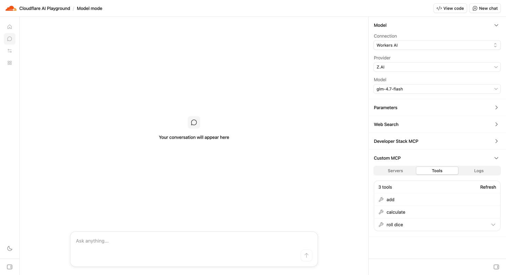

### 5-5. AI にツールを使わせる

入力欄に「サイコロを3個振って、結果を教えて」と書いて送信します。

AI が `roll_dice` を選び、`"count": 3` を付けて呼び出し、返ってきた結果を使って答えます。

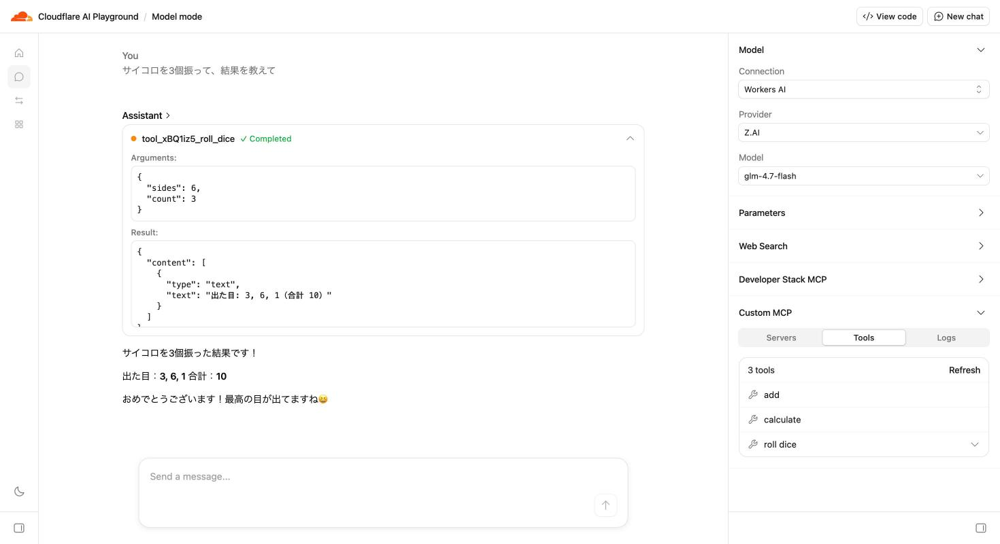

「20面ダイスを2個振って」「12と30を掛けて」なども試してみてください。AI が質問に合わせてツールと引数を選ぶ様子が見られます。

### 5-6. （任意）Claude Desktop からつなぐ

Claude Desktop を使っている人は、設定ファイルに次を追加すると、同じツールを Claude から使えます（`mcp-remote` は、リモート MCP サーバーにつなぐための中継ツールです）。

1. Claude Desktop の **Settings（設定）** → **Developer（開発者）** → **Edit Config（設定を編集）** を開きます。
2. `claude_desktop_config.json` に次を書いて保存し、Claude Desktop を再起動します。

```json
{
	"mcpServers": {
		"handson-dice": {
			"command": "npx",
			"args": ["mcp-remote", "https://handson-mcp-server.<あなたのサブドメイン>.workers.dev/mcp"]
		}
	}
}
```

> 今回の MCP サーバーには **認証がない** ので、URL を知っている人なら誰でも呼べます。サイコロなら問題ありませんが、自分のデータを扱うツールを作るときは、ログイン（OAuth）付きの構成にしてください。作り方は公式ドキュメントの「Remote MCP server」ガイドにあります。

---

## パート 6：片付け

作ったものは無料枠の中で動いているので、残しておいても料金はかかりません。消したい場合は次の手順で消します。

1. ダッシュボードの **コンピュート** → **Workers & Pages** を開きます。
2. 消したいもの（`handson-static-site`・`handson-chat-api`・`handson-mcp-server`）を開きます。
3. **設定** タブを開き、一番下の **危険ゾーン** にある **削除** を押します。確認画面の指示に従って削除します。

R2 のバケットは、**R2 オブジェクトストレージ** で `handson-bucket` を開き、**設定** タブの一番下で **バケットを空にする** → **バケットを削除する** の順に実行します。

AI Playground に登録した MCP サーバーは、Custom MCP の欄にあるサーバー右側の `…` から削除できます。

---

## うまくいかないとき

| 症状 | 対処 |
|---|---|
| `command not found: node` / `npm` | Node.js のインストール後、ターミナルを開き直す |
| `npm create` の途中で止まった | `Ctrl + C` で中断し、できかけのフォルダを消してからやり直す |
| `wrangler deploy` で `You need to log in` | `npx wrangler login` をもう一度実行する |
| チャットで `Error` や空の回答が返る | `wrangler.jsonc` に `"ai"` のバインディングがあるか、`,` が抜けていないか確認する |
| Playground で MCP サーバーが Ready にならない | URL の最後に `/mcp` が付いているか、`https://` から始まっているか確認する |
| Workers AI で上限エラー | 1 日 1 万ニューロンの無料枠を超えた。UTC の 0 時（日本時間の朝 9 時）にリセットされる |

## 参考資料（公式）

- Workers AI の始め方：<https://developers.cloudflare.com/workers-ai/get-started/workers-wrangler/>
- リモート MCP サーバーの作り方：<https://developers.cloudflare.com/agents/guides/remote-mcp-server/>
- Workers AI の料金と無料枠：<https://developers.cloudflare.com/workers-ai/platform/pricing/>
- 静的ファイルの公開（Workers Static Assets）：<https://developers.cloudflare.com/workers/static-assets/>
- R2：<https://developers.cloudflare.com/r2/>
